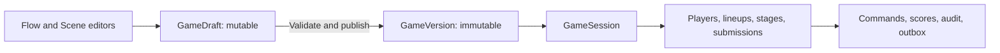

# Database architecture and migrations

Implemented foundation, 11 November 2026. Durable commands, individual scoring and the verified room/network gateway now use these tables; see [command-service scope](game-commands.md) and [network checkpoint](../testing/network-checkpoint.md). Editors, voting/team engines and final production operations remain future work.

## One database per environment

Use **one PostgreSQL database per environment**, containing both authored definitions and live-session records. Flow and Scene views edit the same GameDraft. There is no database per editor, per game, per room, or per player.

- `party_dev`: persistent local development database, localhost port 55432.
- `party_test`: separate disposable integration-test database, localhost port 55433.
- Production: separate database/credentials on the Pi or NUC; not created here.

Logical separation is by tables and relationships, initially in PostgreSQL's `public` schema. Database users/permissions and backend authorization control access; table grouping alone is not a security boundary. The browser never connects to PostgreSQL directly. Splitting authoring/runtime into independent databases would complicate atomic publishing and session/version references without an established need at this scale.

## Lifecycle



Publishing creates a numbered snapshot. A GameSession references that version; later edits to the draft cannot alter it. Live adjustments belong to session/stage state or presentation overrides, not mutation of the published snapshot. Rehearsal sessions are distinguished by mode and never share participant/score rows with live sessions.

The database forbids updates/deletes to published versions and key history tables. This prevents accidental mutation by application code; a database owner/superuser can still change database protections. A future intentional retention/purge procedure needs explicit design because ordinary cascading deletion is restricted.

## Schema: 19 models

Authoritative definitions: [schema.prisma](../../apps/server/database/schema.prisma).

| Group | Model / table | Important fields and relationships |
| --- | --- | --- |
| Authoring | Creator / creators | UUID; unique issuer+subject for verified external identity; no passwords |
| Authoring | Game / games | Owner, title, archive timestamp; parent of draft and versions |
| Authoring | GameDraft / game_drafts | One per game; revision; format version; JSONB definition; updated timestamp |
| Authoring | GameVersion / game_versions | Unique game+version number; definition snapshot, format, content hash, publishing creator |
| Runtime | GameSession / game_sessions | Published version, host, live/rehearsal mode, status, room code, state revision, current node, private state snapshot |
| Runtime | SessionPlayer / session_players | Session-scoped identity, nickname, join/departure timestamps, optional unique opaque join-key hash |
| Runtime | PlayerCredential / player_credentials | Player/session reference, unique token hash, expiry and revocation; no raw tokens |
| Runtime | RoomCredential / room_credentials | Expiring/revocable host/display token hash, session role and OIDC/local-rehearsal source |
| Runtime | SessionTeam / session_teams | Named team within a session |
| Runtime | TeamLineup / team_lineups | Numbered membership snapshot and carryover metadata |
| Runtime | TeamMember / team_members | Player+team+lineup; one team per player per lineup; at most one captain per team/lineup |
| Runtime | StageRun / stage_runs | Numbered execution of node/stage; lifecycle, lineup, eligibility snapshot, deadline or paused remaining time, presentation override |
| Runtime | Submission / submissions | Stage, player or team actor, response slot, revision, private JSONB value, server receipt time |
| Runtime | RouteDecision / route_decisions | One resolution per choice stage; selected edge/destination, reason, vote snapshot and command reference |
| Reliability | GameCommand / game_commands | Unique session+actor+command key, request hash, committed result |
| Runtime history | StageJudgment / stage_judgments | One immutable judgment per stage+player, including zero awards; same-session stage/player/command references |
| Reliability | ScoreEntry / score_entries | Recipient player or team, exact signed amount, source command/stage/lineup, award key, correction/transfer references |
| Reliability | AuditEvent / audit_events | Session revision+event index, command reference, event kind, private structured details |
| Reliability | OutboxEvent / outbox_events | Ordered session events, intended audience/key, payload, attempts, next availability and publish timestamp |

UUID identifiers are generated by PostgreSQL. Timestamps use timezone-aware PostgreSQL timestamps. Composite foreign keys prevent a stage, player, team, lineup, command, or score reference from pointing into a different session.

### What is JSONB and why?

The game definition contains the scene graph, stage/template configuration, supported game/round themes, media references, and authoring layout. Keeping this as one versioned JSONB document allows atomic draft saves and immutable publishing without prematurely normalizing every configurable mechanic. The intended document shape is still subject to typed runtime validation when authoring services are implemented.

Runtime identities, accepted submissions, scores, decisions, and recovery records are relational tables. Their JSONB fields hold payloads/snapshots, not substitutes for relational IDs or integrity constraints. Definitions/submissions may contain secrets such as answers; full records must never be sent to unauthorized phones or copied into diagnostic logs.

Current SQL checks validate basic object/envelope shape, not complete graph semantics, answer correctness, vote eligibility, deadlines, or author permissions. Those still require backend services and tests. `currentNodeKey` and route edge keys refer into the versioned definition; application validation must resolve them.

### Scores

Store signed `amountMilli` as PostgreSQL BIGINT: **1,000 milli-points = 1 point**. Use BigInt/exact integer operations; values above JavaScript's safe integer limit round-trip correctly in integration tests. Public APIs must explicitly serialize them as exact strings or bounded decimal representations, not raw JSON BigInt or floating-point conversions.

Whole-number scoring remains the default. Fractional split/remainder policy must preserve totals at the supported 0.001-point precision and be specified by scoring services. Database checks prevent zero entries, missing/ambiguous recipients, duplicate award keys, and more than one full-reversal row per original entry. They do not prove transfer sums balance or that a reversal negates the correct original amount; those are later transactional service invariants.

## Code-first tooling

Pinned **Prisma 7.10.1** CLI/client/adapter, PostgreSQL 18.6 container. At setup time, the npm default Prisma CLI tag pointed to an 8.0 release candidate. We deliberately use matching stable 7.10.1 packages and their versioned documentation; do not apply Prisma 8 commands to this project.

- `apps/server/database/schema.prisma`: code-first model definitions.
- `apps/server/database/migrations/`: generated initial migration plus reviewed PostgreSQL integrity migration.
- `apps/server/prisma.config.ts`: backend-owned schema/migration configuration.
- `apps/server/src/database/client.ts`: bounded pool, typed client, connectivity probe and pool diagnostics.
- `scripts/database/`: environment initialization, guarded CLI wrappers, container/test commands.
- `infra/database/compose.yaml`: local-only development/test services.

The second migration owns CHECK constraints, partial unique indexes, and immutability triggers that Prisma's schema language cannot represent. Keep them in reviewed migration history. Prisma's schema diff cannot verify all such custom objects; integration tests are required alongside drift/status checks.

The third migration adds StageJudgment, its nonnegative-amount check and immutable-history trigger. It is a new additive migration; the first two applied migrations are unchanged. Zero-point judgments need their own durable record because the score ledger intentionally rejects zero-value entries.

The fourth migration adds room credentials and a nullable unique player join-key hash. Existing players remain intact with null join hashes. Tokens and join keys are never stored raw in PostgreSQL. Reviewed lifetime/hash checks supplement the Prisma schema. This migration is additive; earlier applied migrations remain unchanged.

## Local setup

```sh
npm ci
npm run db:env
npm run db:up
npm run db:generate
npm run db:migrate:deploy
npm run db:status
npm run db:drift
```

`db:env` creates an ignored mode-0600 `.env` with random local credentials only if absent. It never overwrites an existing `.env` or prints credentials. If one exists, add missing database settings using `.env.example`. CLI wrappers load the root `.env` and respect already provided environment values.

Containers bind only to localhost. Development data is in a named volume; stopping the service does not remove it. Test storage is tmpfs and is disposable. This compose file is not a production deployment: do not expose/reuse its development database role or credentials for home-server public access.

```sh
npm run db:migrate:create -- --name describe_change
# Review the new SQL; add backfills/constraints as appropriate.
npm run db:migrate:dev
npm run db:generate
npm run db:status
npm run db:drift
```

Development migration commands are guarded to local `_dev` targets. Deploy applies existing reviewed migrations and does not generate changes. No reset or schema-push convenience command is provided. Never modify an already applied migration. A new migration corrects a deployed issue.

Generate and validate work without a database connection. Generated client files are ignored and recreated by root build/test commands; credentials are never embedded in that client. No migrations execute automatically in HTTP requests or when starting the game server.

## Integration verification

```sh
npm run db:test:up
npm run db:test
npm run db:test:stop
npm run check
```

The test wrapper requires an explicitly configured local `TEST_DATABASE_URL` ending in `_test`, applies migrations twice to verify repeat deployment, then runs the database suite. The normal offline suite excludes database tests. The upgrade test creates and drops only its uniquely named disposable `_test` database, applies the initial SQL, inserts data, and applies the integrity migration. This currently requires the isolated test role to have CREATEDB; production runtime roles should not.

Coverage: draft/version isolation and immutability, duplicate commands/submissions/awards, cross-session references, actor consistency, one active stage, team captain constraints, exact scores and corrections, atomic rollback across command/submission/audit/outbox, record persistence across client recreation, immutable branch resolution, and populated-schema upgrade preservation.

The command service now has a [verified room/network gateway](../testing/network-checkpoint.md): guest/host/display credentials, HTTP admission, Socket.IO snapshots/receipts, bounded outbox publication and single-backend startup pausing. Tests exercise real transports, 20 clients and browser recovery. Real-phone acceptance is pending. Still unimplemented: full creator sign-in/authoring, cross-device reclaim, timed admission/close policy, team/carryover/correction services, purge/retention and a production migration role. Table availability alone does not establish those guarantees.

## Health and administration

Liveness never probes PostgreSQL. Readiness checks database connectivity plus authentication configuration; it does not prove provider availability or complete schema compatibility. Deployment must check migration status/drift separately. Protected `/api/ops/metrics` now includes pool capacity/usage, waiters, last connectivity-probe duration and last known health. These are not timings for every gameplay query.

Game history stays in PostgreSQL. High-frequency performance metrics/logs should remain in bounded telemetry storage, not become extra game-table writes per animation or timer tick. A private admin dashboard is planned separately; no dashboard UI or privileged controls are built by this change.

## Planned creative-content extensions

Player avatars, upload metadata, drawing checkpoints, creation lineage and frame/turn ownership are not present in the schema. The [creative-content plan](creative-minigames.md#storage-and-database-evolution) describes proposed additions and a staged file/database lifecycle. Add reviewed new migrations only when implementing those slices; do not rewrite the existing applied migrations. Use the same environment database and separate managed file storage, with authorized access and coordinated backups. Design retention/tombstones around immutable history rather than embedding personal images in append-only records.
