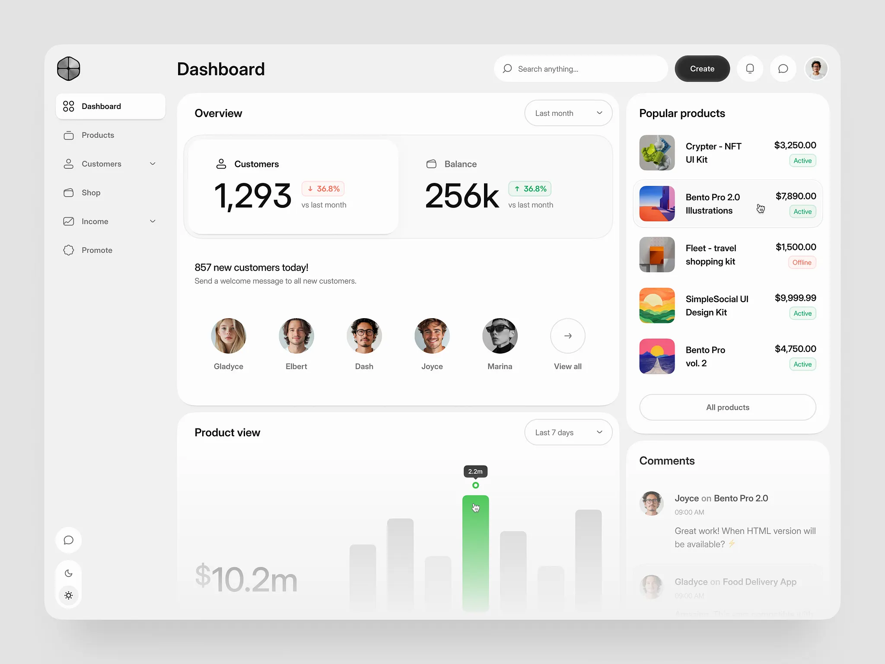
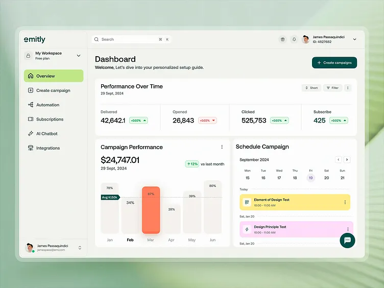

# Design references

Accepted on 11 November 2026. These files are design documentation, not the application editors.

## Interactive layout and behavior reference

Open [editor-reference.html](editor-reference.html) in a browser to explore both Flow editor and Scene editor. The [editable source fragment](editor-reference.source.html) is preserved so the reference does not depend on the original chat location. The standalone export was generated from that source using the visualization renderer.

The example demonstrates:

- A high-level scene graph and a classic PowerPoint-style scene list/editor.
- One party-choice node, two alternative routes, and a shared finale.
- Selecting scenes, switching editor views, and shared title/settings updates.
- Previewing Music or Physical routes and host/phone presentation.

This is the approved interaction/layout reference, not a full implementation specification or final game theme. Connections and handles are illustrative. Node dragging, line dragging/snapping, new scene creation, live voting, persistence, and multiplayer execution are not implemented in this example. Its validation/status text describes the fixed example graph; it is not a general graph validator.

## Builder visual direction

The user subsequently supplied these images as the workspace-style direction:

- [Neutral rounded workspace](assets/builder-neutral-reference.png): neutral light surfaces, black typography, rounded panels, subtle boundaries and generous spacing.
- [Restrained accent workspace](assets/builder-accent-reference.png): clean professional layout with limited accent color and consistent control shapes.

Use one coherent professional builder design system in light, dark, or system mode. Multiple decorative workspace themes are not required. The images are user-supplied inspiration; their original products/creators have not been identified, and no asset reuse rights are asserted. Do not copy logos, avatars, illustrations, or unrelated dashboard features into the application.

The earlier interactive example's purple workspace accent is provisional. Follow the newer screenshot direction for workspace styling while retaining the accepted editor structure. Game themes and per-round presentation overrides remain separately configurable and may be much more expressive than the workspace.

## Connection interaction requirements

Snap-to-port behavior, valid-target highlighting, zoom-independent hit areas, cancellation, reconnection, alignment, accessible alternatives, and graph validation are specified in [APP_PLAN.md, section 23.5](../../APP_PLAN.md#235-connection-handles-snapping-and-node-alignment). These are requirements for later implementation, not capabilities of the saved example.

Nothing in this directory is imported by the frontend/backend, and saving these references does not start the actual editor build.

## Private admin health reference

Open [admin-health-reference.html](admin-health-reference.html) in a browser to explore the proposed private health dashboard. Its [editable source fragment](admin-health-reference.source.html) is preserved alongside the standalone export.

The example shows session health, saved-confirmation latency, server processing, database connectivity, connected players, a latency trend, resource measurements, and sanitized diagnostic records. It distinguishes server processing from end-to-end confirmation and database probe time from commit time.

All measurements, players, logs, and identifiers are illustrative sample data. Pause/resume, reconnect display, temporary debug logging, and command inspection only change local example state. They do not contact a server, control a session, or implement permissions, automatic debug expiry, monitoring, or recovery. The current backend metrics foundation is documented separately in the root README; the actual admin dashboard remains unbuilt.

See [APP_PLAN.md, section 24.2](../../APP_PLAN.md#242-private-admin-dashboard-planned-not-built) for planned measurements, access boundaries, and controls.
